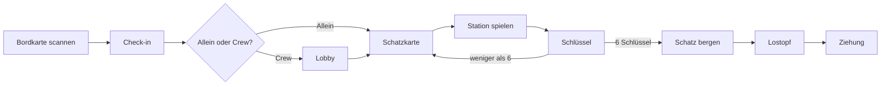

# Konzept – Übersicht

Fachliches Konzept der Schatzsuche „Xmas Ahoi!“ für die Weihnachtsfeier am 20. November 2026. Bestandsaufnahme aus Trilium („Projekt Xmas Ahoi – Schatzsuche Weihnachtsfeier“), Stand 22.10.2026. Die technische Umsetzung liegt unter [project/](../project/README.md).

## Stand

- Der grobe Ablauf der mobilen Webseite ist abgestimmt und als Wireframes gezeichnet.
- Fünf von sechs Minispielen sind beschrieben; die offenen Fragen stehen auf den Spielseiten.
- Die Spielideen der Recherchephase sind nicht die Grundlage; sie liegen im [Archiv](archiv/archiv.md).
- Bisher gibt es keine Programmierung.

## Ablauf aus Sicht einer Person

Vom Scannen der Bordkarte bis zur Ziehung:

## Dokumente

### Rahmen

- [Rahmen der Feier](rahmen/rahmen-der-feier.md): Motto, Zeitlimits, Preise, technische Vorgaben, Vorgehen

### Framework (Spielablauf)

1. [Grundprinzip](framework/grundprinzip.md): Stationen, Schlüssel, Lostopf, Spielerkonten
2. [Eingang und Bordkarte](framework/eingang-und-bordkarte.md): QR-Code, Textcode, Check-in
3. [Crews](framework/crews.md): gründen, beitreten, Lobby, austreten
4. [Karte und Stationen](framework/karte-und-stationen.md): Schatzkarte, Anwesenheit, Schlüsselvergabe
5. [Hinweise, Abbruch und Exit](framework/hinweise-abbruch-exit.md): Mindestzeiten, Zustimmung, Log
6. [Spielstand und Wiedereinstieg](framework/spielstand-und-wiedereinstieg.md)
7. [Finale, Ende-Seite und Ziehung](framework/finale-und-ziehung.md)
8. [Betrieb, Datenschutz und Risiken](framework/betrieb-datenschutz-risiken.md)
9. [Wireframes: Spieler-Flow](framework/wireframes-spieler-flow.md): 26 Screens

### Admin

- [Admin-Panel](admin/admin-panel.md): Login, Schalter, Nutzer, Crews, Ziehung, Log
- [Wireframes: Admin-Panel](admin/wireframes-admin.md): 5 Screens

### Minispiele

- [Spielübergreifende Punkte](spiele/uebergreifend.md)

| Nr. | Spiel | Ort | Stand |
|-----|-------|-----|-------|
| 1 | [Quiz](spiele/spiel-1-quiz/quiz.md) | nur Handy | beschrieben |
| 2 | [Navigator](spiele/spiel-2-navigator/navigator.md) | Handy, optional ein Blatt | beschrieben, Aufgabe C offen |
| 3 | [Morsezeichen](spiele/spiel-3-morsezeichen/morsezeichen.md) | nur Handy | beschrieben |
| 4 | [Knoten machen](spiele/spiel-4-knoten/knoten.md) | Raum (Seile, Karten) | beschrieben |
| 5 | [Begriffe finden](spiele/spiel-5-begriffe-finden/begriffe-finden.md) | Raum (Schilder) | beschrieben |
| 6 | [noch offen](spiele/spiel-6-offen/spiel-6.md) | offen | nur Ideen |

### Archiv

- [Archiv](archiv/archiv.md): Verzeichnis der alten Trilium-Seiten, nur Referenz

## Offene Punkte

Jede Seite führt ihre offenen Punkte im Abschnitt „Offene Punkte“ oder „Offene Fragen und Widersprüche“.

## Wortwahl

- „Crew“ ist der Begriff in der Oberfläche; die Spielseiten sagen „Gruppe“ für 1 bis 3 Personen (auch Einzelspieler).
- Auf den Spielseiten sind „Beschreibung“ und „Variationen“ die Vorgabe des Veranstalters; „Aufbau (Empfehlung)“ und „Offene Fragen“ stammen aus der Durchsicht und sind nicht entschieden.
