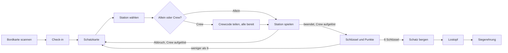

# Konzept – Übersicht

Fachliches Konzept der Schatzsuche „Xmas Ahoi!“ für die Weihnachtsfeier am 20. November 2026. Die technische Umsetzung liegt unter [project/](../project/README.md).

## Stand

- Der grobe Ablauf der mobilen Webseite ist abgestimmt und als Wireframes gezeichnet. Die Wireframes zeigen noch feste Crews; was neu zu zeichnen ist, steht auf den Wireframe-Seiten.
- Alle sechs Minispiele sind beschrieben; die offenen Fragen stehen auf den Spielseiten.
- Bisher gibt es keine Programmierung.

## Ablauf aus Sicht einer Person

Vom Scannen der Bordkarte bis zur Siegerehrung. Die Crew bildet sich erst an der Station und löst sich nach ihr wieder auf:

## Dokumente

### Rahmen

- [Rahmen der Feier](rahmen/rahmen-der-feier.md): Motto, Zeitbudget, Preise, technische Vorgaben, Vorgehen

### Framework (Spielablauf)

1. [Grundprinzip](framework/grundprinzip.md): Stationen, Schlüssel, Punkte, Lostopf, Spielerkonten
2. [Eingang und Bordkarte](framework/eingang-und-bordkarte.md): QR-Code, Textcode, Check-in
3. [Crews](framework/crews.md): Crew je Station bilden und beitreten
4. [Karte und Stationen](framework/karte-und-stationen.md): Schatzkarte, Schlüssel und Punkte, Verbindungsverlust
5. [Hinweise, Abbruch und Exit](framework/hinweise-abbruch-exit.md): Hinweis-Takt, Zustimmung, Log
6. [Spielstand und Wiedereinstieg](framework/spielstand-und-wiedereinstieg.md)
7. [Finale, Ende-Seite und Siegerehrung](framework/finale-und-ziehung.md)
8. [Betrieb, Datenschutz und Risiken](framework/betrieb-datenschutz-risiken.md)
9. [Wireframes: Spieler-Flow](framework/wireframes-spieler-flow.md): 26 Screens

### Admin

- [Admin-Panel](admin/admin-panel.md): Login, Schalter, Nutzer, Rangliste, Log
- [Wireframes: Admin-Panel](admin/wireframes-admin.md): 5 Screens

### Minispiele

- [Spielübergreifende Punkte](spiele/uebergreifend.md): Spieltypen und Punkte, Spiele mit Material im Raum

| Nr. | Spiel | Ort | Stand |
|-----|-------|-----|-------|
| 1 | [Quiz](spiele/spiel-1-quiz/quiz.md) | nur Handy | beschrieben |
| 2 | [Peilung](spiele/spiel-2-peilung/peilung.md) | nur Handy | beschrieben |
| 3 | [Morsezeichen](spiele/spiel-3-morsezeichen/morsezeichen.md) | Raum (Funkstation, Tischkarten) | beschrieben, Satzlänge im Testlauf |
| 4 | [Fischfang](spiele/spiel-4-fischfang/fischfang.md) | Raum (Fischteich, Angeln) | beschrieben, Fänge im Testlauf |
| 5 | [Seemannsgarn](spiele/spiel-5-seemannsgarn/seemannsgarn.md) | Raum (Erzähltisch, Faktentafeln) | beschrieben, Laufzeit im Testlauf |
| 6 | [Kurs setzen](spiele/spiel-6-kurs-setzen/kurs-setzen.md) | Raum (Seekarte, Logbuchkarten) | beschrieben, Zeiten im Testlauf |

## Offene Punkte

Jede Seite führt ihre offenen Punkte im Abschnitt „Offene Punkte“ oder „Offene Fragen und Widersprüche“.

## Wortwahl

- Fachbegriffe wie „Crew“, „Rätsel“ und „Punktespiel“ stehen im [Glossar](../CONTEXT.md).
- Auf den Spielseiten sind „Beschreibung“ und „Variationen“ die Vorgabe des Veranstalters; „Aufbau (Empfehlung)“ und „Offene Fragen“ stammen aus der Durchsicht und sind nicht entschieden.
