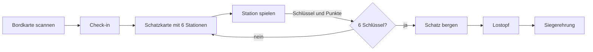
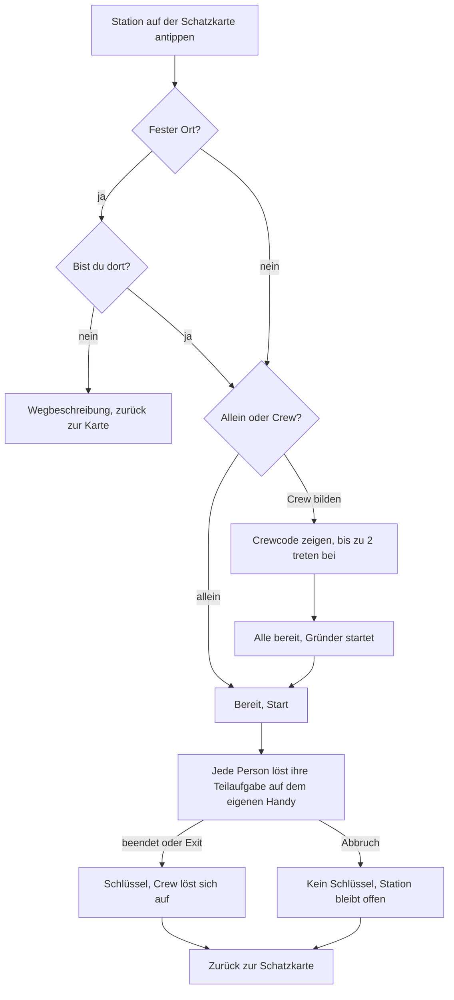
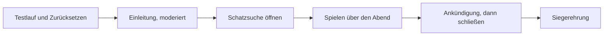
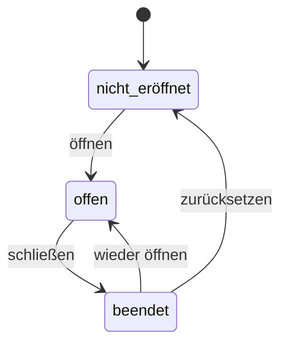

# Pitch: Xmas Ahoi!

Stand 29.10.2026 · [Übersicht](README.md)

Kurzfassung des Konzepts für die Vorstellung. Verbindlich sind die verlinkten Konzeptseiten; Fachbegriffe stehen im [Glossar](../CONTEXT.md).

## In einem Satz

Eine unbetreute Schatzsuche auf dem Handy für die Weihnachtsfeier am 20. November 2026: Alle spielen über den Abend verteilt sechs Minispiele, allein oder in einer Crew, die sich an der Station spontan bildet, und sammeln Schlüssel für die Schatztruhe und Punkte für die Rangliste.

## Die Idee

- **Motto:** „Xmas Ahoi!“ an Bord der „MS Web Care“, Ziel ist der Hafen „Beyond The Fog“.
- **Wer:** rund 80 Gäste, davon etwa 60 Mitspielende.
- **Womit:** eine mobile Webseite, keine App. Die persönliche Bordkarte mit QR-Code ist das Ticket.
- **Wann:** asynchron den ganzen Abend, Pausen sind jederzeit möglich. Je Spiel etwa 5 Minuten, zusammen höchstens 30.
- **Wie:** Keine Station ist betreut. Moderiert sind nur die Einleitung und die Siegerehrung; das [Orgateam](../CONTEXT.md) hilft bei Fragen.
- **Warum es verbindet:** Crews bilden sich an jeder Station neu, und Firmenwissen steckt in Quiz und Logbuch.

## Spielprinzip

Sechs Stationen, sechs Schlüssel, eine Truhe. Wer sie birgt, kommt in den Lostopf:



Was eine Station bringt:

| Ausgang | Schlüssel | Punkte |
|---------|-----------|--------|
| beendet | ja | 0 bis 100 |
| Exit (nur Rätsel) | ja | 0 |
| Zeitablauf nach der Höchstzeit (nur Rätsel) | ja | 0 |
| Abbruch | nein | keine, die Station wird neu gespielt |

Jedes Spiel hat einen von zwei Spieltypen:

| Spieltyp | Spiele | Zeit | Hilfe | Punkte |
|----------|--------|------|-------|--------|
| Rätsel | Morsezeichen, Fischfang, Seemannsgarn | Höchstzeit 10 Min. (Morsezeichen 5), ohne Druck | 2 Hinweise und Exit | 100 minus 25 je Hinweis; Zeitablauf 0 |
| Punktespiel | Quiz, Peilung, Kurs setzen | festes Zeitlimit | keine | Anteil der Treffer |

Alle in einer Crew bekommen dieselben Punkte. Weil die Aufgaben mit der Crew wachsen, zählt die Quote; Einzelspieler und Crews sind so vergleichbar. Details: [Grundprinzip](framework/grundprinzip.md), [Spielübergreifend](spiele/uebergreifend.md).

## Die sechs Spiele

| Nr. | Spiel | Typ | Ort | In Kürze |
|-----|-------|-----|-----|----------|
| 1 | [Quiz](spiele/spiel-1-quiz/quiz.md) | Punktespiel | Handy | 5 Fragen je Person in 2 Minuten, auch zur Firma |
| 2 | [Peilung](spiele/spiel-2-peilung/peilung.md) | Punktespiel | Handy | Küstenfotos auf der Weltkarte verorten |
| 3 | [Morsezeichen](spiele/spiel-3-morsezeichen/morsezeichen.md) | Rätsel | Funkstation | Funkspruch per Leuchtfeld entschlüsseln und sortieren |
| 4 | [Fischfang](spiele/spiel-4-fischfang/fischfang.md) | Rätsel | Fischteich | Muster einer Fischreihe erkennen, den fehlenden Fisch angeln |
| 5 | [Seemannsgarn](spiele/spiel-5-seemannsgarn/seemannsgarn.md) | Rätsel | Erzähltisch und 4 Faktentafeln | Geschichte lesen, die passenden Fakten im Raum finden |
| 6 | [Kurs setzen](spiele/spiel-6-kurs-setzen/kurs-setzen.md) | Punktespiel | Kartentisch | Mit Logbuch-Codes einen Kurs auf der Seekarte fahren |

### 1 · Quiz

Jede Person bekommt 5 eigene Fragen aus vier Kategorien: Schätzfragen, Allgemeinwissen, Sport und Firma. Die Crew hat 2 Minuten für alle Fragen; jede Antwort zählt sofort, Überspringen geht nicht.

**Vorbereitung:**

- Fragenpool mit 80 Fragen schreiben, 20 je Kategorie, jede mit 4 Antworten und der richtigen Antwort.
- Kein Material im Raum.

### 2 · Peilung

Jede Person sieht 3 Fotos von Küsten und Meer und setzt je einen Pin auf eine Weltkarte. Bis 400 km Abstand gibt es volle Punkte, danach weniger; die Crew hat 2 Minuten.

**Vorbereitung:**

- 40 Fotos von Küsten und Meer beschaffen, jedes mit bekanntem Aufnahmeort (Breiten- und Längengrad) und freier Lizenz. Gut sind erkennbare Merkmale wie Vegetation oder ein Leuchtturm, keine Ortsschilder.
- Kein Material im Raum; die Karte kommt kostenlos von OpenStreetMap.

### 3 · Morsezeichen

Die Crew fängt einen Funkspruch ab. Jedes Handy morst ein Wort als Leuchtfeld, optional mit Ton; die Morsetabelle liegt als Tischkarte an der Funkstation. Gelöste Wörter erscheinen bei allen, danach sortiert die Crew den Satz.

**Vorbereitung:**

- 30 Funksprüche schreiben, 10 je Crewgröße, mit maritimen und Firmenbegriffen, ohne Umlaute.
- 2 bis 3 laminierte Tischkarten mit der Morsetabelle.
- Notizblock und Stift an der Funkstation, Ersatz beim Orgateam.
- Platz für die Funkstation festlegen.

### 4 · Fischfang

Das Handy zeigt 3 Fische und ein „?“. Farbe und Steuerrad folgen einem Muster; die Person findet den nächsten Fisch, angelt ihn aus dem Teich und tippt den Code von seiner Unterseite ein. 3 Fänge je Person, jede Reihe etwas schwerer.

**Vorbereitung:** Fischfang braucht das meiste Material.

- 24 schwimmende Fische bauen, die sich von selbst aufrichten: oben Öse und Steuerrad mit markierter Speiche, unten ein 4-stelliger Code. 4 Farben mal 6 Stellungen, jeder Fisch genau einmal. Dazu Ersatzfische beim Orgateam.
- 3 Angeln mit Haken und 1 Ersatzangel.
- Wanne für den Fischteich, Wasser, Handtücher als Unterlage.
- Schild am Teich: „Nur mit der Angel fangen. Fische nach dem Spiel zurück in den Teich.“
- Wasser im Gastraum mit dem Restaurant absprechen (Empfehlung: zusammen mit der Deko bis 13.11.).

### 5 · Seemannsgarn

Jede Person liest am Erzähltisch eine Geschichte über einen bekannten Seefahrer, ohne Namen. Danach sucht sie an 4 Faktentafeln im Raum je die passende Karte. Stimmen alle 4 Buchstaben, verrät das Handy den Namen: „Das war James Cook!“

**Vorbereitung:**

- Inhalte recherchieren: 8 bekannte Seefahrer, je eine Geschichte mit etwa 100 Wörtern ohne Namen und je ein Fakt zu jedem der 4 Tafelthemen, dazu die Zuordnung der Buchstaben.
- 8 Geschichten auf Aufstellern oder laminierten Karten, fest am Erzähltisch.
- 4 Faktentafeln mit zusammen 32 Faktenkarten, fest angebracht. Ersatzkarten beim Orgateam.
- Plätze für Erzähltisch und Faktentafeln festlegen, die Tafeln im Gastraum, höchstens eine draußen.

### 6 · Kurs setzen

Jede Ziffer eines Codes zeigt auf eine Logbuchkarte mit Anweisungen wie „Segle 3 Felder nach Osten“. Mit dem Finger fährt die Person den Kurs auf der Seekarte und gibt das Zielfeld ab. In einer Crew sind die Ziffern über die Handys verteilt, man muss sich also absprechen.

**Vorbereitung:**

- Seekarte mit 8×8 Feldern gestalten: etwa 14 Symbole (Hafen, Leuchtturm, Insel, Riff, Wrack) mit Namen aus der Firma.
- 10 Logbuchkarten mit je 6 Anweisungen schreiben, darunter 10 Firmenwissen-Fragen mit eindeutiger Ja/Nein-Antwort.
- Seekarte in A3 und Logbuchkarten in A6 drucken, laminieren und mit Klebeband am Kartentisch fixieren. Ein Ersatzsatz beim Orgateam.
- Keine Spielfiguren nötig.

## Workflow für Spielende

### Eine Station spielen



- Eine Crew hat höchstens 3 Personen und gilt nur für diese eine Station. Es gibt keine festen Crews und keine Crewkonten ([Crews](framework/crews.md)).
- Jede Person beendet jede Station genau einmal.
- Der Spielstand liegt auf dem Server. Wer die Seite schließt oder das Handy wechselt, scannt die Bordkarte erneut und ist wieder an derselben Stelle ([Spielstand und Wiedereinstieg](framework/spielstand-und-wiedereinstieg.md)).
- Fällt in einer Crew jemand aus, wartet die Crew, bis die Person zurück ist, oder bricht ab.

### Hinweise und Exit bei Rätseln

Der Takt ist für alle Rätsel gleich ([Hinweise, Abbruch und Exit](framework/hinweise-abbruch-exit.md)):

```
0:00  Start des Durchlaufs
0:30  Hinweis 1 möglich            kostet die Crew 25 Punkte
1:30  Hinweis 2 frühestens         kostet die Crew 25 Punkte
2:30  Exit frühestens              Schlüssel, 0 Punkte, alle stimmen zu
5:00  Morsezeichen                 Zeitablauf: Schlüssel, 0 Punkte
10:00 Fischfang, Seemannsgarn      Zeitablauf: Schlüssel, 0 Punkte
```

Den Hinweistext sieht nur, wer ihn nimmt; bei Morsezeichen sieht ihn die ganze Crew.

## Ablauf des Abends



1. **Vorher:** Bordkarten drucken, Material an den vier festen Orten aufbauen, Testlauf mit eigenen Testkarten, danach zurücksetzen.
2. **Einleitung:** Ablauf erklären, die Orte der Spiele zeigen, das Orgateam vorstellen.
3. **Öffnen:** Der Admin schaltet die Schatzsuche frei.
4. **Spielen:** Alle spielen in eigenem Tempo. Das Orgateam sieht 2 bis 3 Mal nach dem Material.
5. **Schließen:** Das Orgateam kündigt das Ende an („noch 5 Minuten“), dann schließt der Admin. Laufende Durchläufe verfallen.
6. **Siegerehrung:** Der Veranstalter moderiert und zeigt die Ergebnisse über das Admin-Panel.

## Preise und Siegerehrung

- Nur wer die Schatztruhe geborgen hat, ist im Lostopf. Alle im Lostopf bekommen mindestens einen Trostpreis; wer das Ende nicht erreicht, bekommt nichts.
- **Plätze 1 bis 3** werden aus dem Lostopf gezogen, unabhängig von den Punkten. Preise bis 20 EUR. Der Admin kann jeden Platz neu ziehen.
- **6 Ehrungen** mit Preisen bis 10 EUR:

| Ehrung | Wer sie bekommt |
|--------|-----------------|
| Bester Seefahrer | die meisten Punkte |
| Teamplayer | die meisten Mitspieler über alle Stationen |
| Schnellste Schatztruhe | die kürzeste Zeit von der ersten Station bis „Schatz bergen“ |
| Schnellster Rätselknacker | die kürzeste Spielzeit über die drei Rätsel, ohne Exit und Zeitablauf |
| Pechvogel | die meisten Abbrüche |
| Langer Atem | die zuletzt geborgene Schatztruhe |

Punkte und Rangliste bleiben bis zur Siegerehrung verborgen. Regeln: [Finale, Ende-Seite und Siegerehrung](framework/finale-und-ziehung.md).

## Admin-Panel

Der Laptop des Veranstalters dient nur der Verwaltung; das System läuft im Internet ([Admin-Panel](admin/admin-panel.md)).



- Nutzer anlegen, mit oder ohne Namen; das System vergibt den 4-stelligen Code für die Bordkarte.
- Rangliste mit Hinweisen, Exits, Zeitabläufen und Abbrüchen je Person, dazu das Log je Durchlauf, filterbar nach Person.
- Ziehung der Plätze 1 bis 3 (mit „Neu ziehen“) und Auswertung der Ehrungen auf Knopfdruck.

## Fairness, Datenschutz und Risiken

- **Gegen Abschreiben:** Jede Person zieht ihre Aufgaben zufällig aus einem Pool, Fischreihen und Kurs-Codes entstehen jedes Mal neu. Dazu die Bitte beim Check-in: „Ehrensache unter Seeleuten: Lösungen bleiben an Bord.“ Eine technische Erkennung gibt es nicht.
- **Datenschutz:** Gespeichert werden nur Vornamen, Spielstände, Punkte und das Log. Bis 4.12.2026 ist alles gelöscht, Server und Backups eingeschlossen; vorher exportiert das Orgateam anonyme Zahlen für die nächste Feier ([Betrieb, Datenschutz und Risiken](framework/betrieb-datenschutz-risiken.md)).
- **Bewusst akzeptiert:** Mogeln, weitergegebene Bordkarten, leere Akkus, doppelte Vornamen.

## Stand und nächste Schritte

- Konzept, Spielregeln und Wireframes stehen; programmiert ist noch nichts.
- Inhalte und Material je Spiel vorbereiten, siehe „Vorbereitung“ unter [Die sechs Spiele](#die-sechs-spiele).
- Bordkarten mit persönlichem QR-Code und Zugangscode für alle Gäste drucken.
- Umsetzung als Nuxt-Webseite mit Admin-Panel.
- Testlauf: Er legt Zeitlimits, Satzlängen und Fänge je Person endgültig fest.
