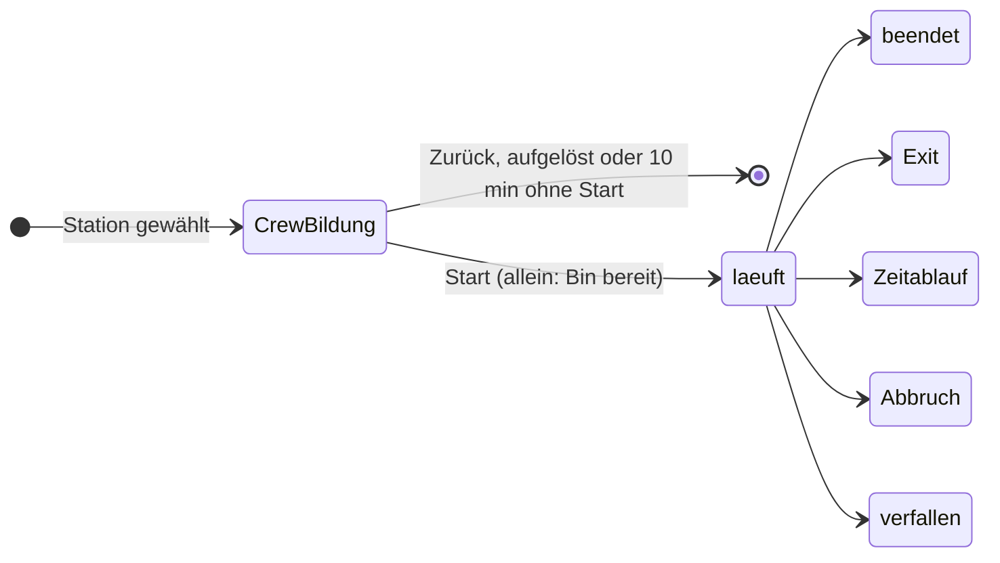

# Durchlauf und Uhren

Stand 29.10.2026 · [Übersicht](README.md)

Wie die Basis einen [Durchlauf](../../CONTEXT.md) einer Station abbildet und wie Höchstzeit, Zeitlimit und Hinweis-Takt auf dem Server ablaufen. Die Spielregeln dazu stehen unter [Hinweise, Abbruch und Exit](../framework/hinweise-abbruch-exit.md) und [Crews](../framework/crews.md).

## Zustände

Ein Durchlauf beginnt mit dem gemeinsamen Start und endet in genau einem von fünf Zuständen:

- Die Crew-Bildung ist kein Durchlauf und steht nicht im Log ([Crews](../framework/crews.md)).

| Ende | Wann | Schlüssel | Punkte |
|------|------|-----------|--------|
| beendet | Rätsel: alle Teilaufgaben gelöst; Punktespiel: alle Teilaufgaben beantwortet oder Zeitlimit abgelaufen | ja | 0–100 |
| Exit | alle in der Crew stimmen zu | ja | 0 |
| Zeitablauf | Höchstzeit eines Rätsels erreicht | ja | 0 |
| Abbruch | eine Person bricht ab | nein | – |
| verfallen | der Admin schließt die Schatzsuche | nein | – |

- Alle Wechsel eines Durchlaufs verarbeitet der Server nacheinander; der erste gewinnt. Ausnahme: Ein Abbruch während einer laufenden Exit-Abstimmung beendet den Durchlauf als Abbruch ([Karte und Stationen](../framework/karte-und-stationen.md)).

## Zustand und Log

- Der Zustand steht in Tabellen: der Durchlauf mit Station, Status, Startzeit, Fristen und Ergebnis, dazu je Spieler seine Teilnahme. Die genauen Tabellen entstehen bei der Umsetzung.
- Jede Änderung schreibt in derselben Transaktion ein Ereignis ins Log. Das Log ist ein Protokoll, nicht die Quelle des Zustands; es wird nur ergänzt, nie geändert.
- Rangliste, Ehrungen und die Spalten im Admin-Panel (Hinweise, Exits, Zeitabläufe, Abbrüche) werden aus Tabellen und Log gezählt.

## Uhren

- Jede Frist steht als fester Zeitpunkt am Durchlauf: Höchstzeit, Zeitlimit, Ende der Hinweis-Sperre, Ende der Frist für die Exit-Zustimmung. Wann Hinweis 1 frei wird (0:30), ergibt sich aus der Startzeit.
- Ein Taktgeber im Pod prüft alle 2 bis 5 Sekunden, ob eine Frist abgelaufen ist, beendet den Durchlauf und schickt das Ereignis an die Handys.
- Jede Anfrage prüft zusätzlich selbst, ob eine Frist vorbei ist. Das fängt einen kurzen Neustart des Pods ab.
- Im Log steht als Zeit die Frist selbst, nicht der Moment, in dem der Server sie bemerkt.
- Die Handys berechnen Restzeit und Sperre des Hinweis-Knopfs aus der Frist und der Uhrzeit des Servers, nicht aus der eigenen Uhr.
- Eine Frist kann nach hinten wandern, falls die Uhren während einer Sperre stehen bleiben sollen (siehe Offene Punkte).

## Offene Punkte

1. Ob Zeitlimit und Höchstzeit während einer Sperre bei Verbindungsverlust stehen bleiben, ist offen ([Karte und Stationen, Verbindung während der Station](../framework/karte-und-stationen.md#verbindung-während-der-station)). Bleiben sie stehen, braucht es ein Ende für den Fall, dass alle in der Crew ausgefallen sind.
