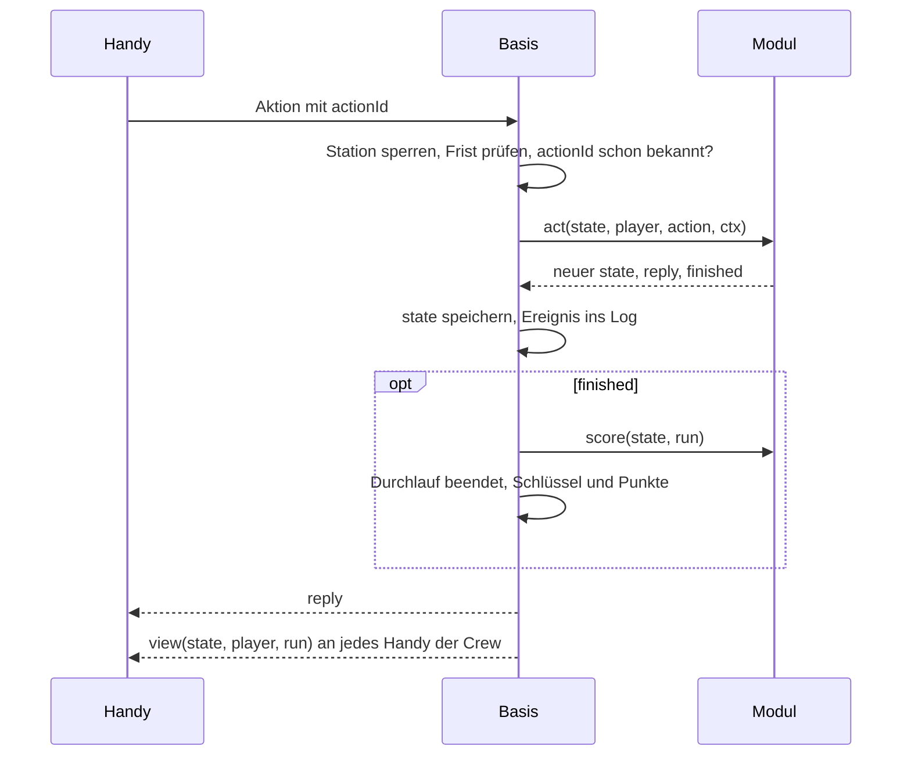

# Spielmodul-Schnittstelle

Stand 29.10.2026 · [Übersicht](README.md)

Der Vertrag zwischen der Basis und den sechs Spielmodulen. Jedes Modul ist in Ablauf und Punkteberechnung in sich geschlossen; die Basis kennt keine Spielregel eines einzelnen Spiels. Zustände und Fristen des Durchlaufs stehen unter [Durchlauf und Uhren](durchlauf-und-uhren.md), die Spielregeln unter [Spielübergreifende Punkte](../spiele/uebergreifend.md).

## Aufteilung

| Basis | Modul |
|-------|-------|
| Crew-Bildung, Start, die fünf Enden eines Durchlaufs | Teilaufgaben oder Funkspruch erzeugen, Inhalte ziehen |
| Fristen: Höchstzeit, Zeitlimit, Hinweis-Takt, Exit-Abstimmung | Antworten prüfen, melden, wann alles gelöst oder beantwortet ist |
| Hinweis-Zähler, Sperre, Rückfrage „Kostet 25 Punkte“ | Inhalt des Hinweises und wer ihn sieht |
| Transaktion, Sperre, Idempotenz, Log | Punkte bei Ende „beendet“ |
| Speichern, was jeder Spieler schon hatte | Eigener Zustand und was jedes Handy davon sieht |
| Rahmen am Handy: Restzeit, Hinweis-Knopf, Exit, Abbruch, „Warte auf deine Crew“ | Inhalt am Handy als eigene Vue-Komponente |
| Verteilen der neuen Ansicht an alle Handys der Crew | – |

## Ablauf einer Aktion

Ein Handy schickt eine Aktion; die Basis führt sie in einer Transaktion aus und verteilt danach jedem in der Crew seine eigene Ansicht.



## Typen

Die Namen im Code folgen der Tabelle [Fachbegriffe im Code](architektur.md#fachbegriffe-im-code).

```ts
type PlayerId = string
type CrewSize = 1 | 2 | 3
type RunEnd = 'finished' | 'exit' | 'timeout' | 'abort' | 'expired'

interface GameMeta {
  id: string                              // 'fischfang'
  type: 'puzzle' | 'scoreGame'
  location?: string                       // 'am Fischteich'
  duration(crew: CrewSize): number        // ms: Höchstzeit oder Zeitlimit
  rules: string                           // Regelkarte
}

interface Ctx {
  now: Date
  random(): number
  seen(player: PlayerId): ReadonlySet<string>
  otherRuns<S>(): readonly S[]            // laufende Durchläufe dieser Station
  pool<T>(name: string): readonly T[]
}

interface RunInfo {
  crew: readonly PlayerId[]
  status: 'running' | RunEnd
  hintsTaken: number
}

interface Action { type: string; payload?: unknown }

interface GameModule<S, V> {
  meta: GameMeta
  start(crew: readonly PlayerId[], ctx: Ctx): { state: S; used: Record<PlayerId, string[]> }
  act(state: S, player: PlayerId, action: Action, ctx: Ctx): { state: S; reply?: unknown; finished?: boolean }
  hint?(state: S, player: PlayerId, level: { person: 1 | 2; crewCount: 1 | 2 }, ctx: Ctx): S  // Pflicht bei Rätseln
  score(state: S, run: RunInfo): number   // 0–100, nur bei Ende „beendet“
  view(state: S, player: PlayerId, run: RunInfo): V
}

// Handy: Vue-Komponente je Modul
defineProps<{ view: V; send: (a: Action) => Promise<unknown> }>()
```

## Regeln

- **Zustand:** Ein JSON-Zustand je Durchlauf, am Durchlauf gespeichert. Teilaufgaben sind ein Detail im Modul; die Basis kennt sie nicht.
- **Reine Funktionen:** Module greifen weder auf die Datenbank noch aufs Netz zu. Zeit und Zufall kommen über `ctx`. So lassen sich Regeln und Punkte ohne Server testen.
- **Ansicht:** `view` liefert, was ein Handy sehen darf, ohne Lösungen. Es zeigt auch das Ergebnis nach dem Ende („3 von 5 richtig“, „Das war James Cook!“, „Legt eure Fische zurück“); dafür trägt `run` den Status.
- **Eingaben:** Das Modul prüft `payload` selbst, denn es kommt vom Handy. Ungültiges ergibt einen Fehler, der Zustand bleibt unverändert. Doppelte Aktionen fängt die Basis über die `actionId` ab, bevor `act` läuft.
- **Ende und Punkte:** `finished` meldet „alles gelöst“ (Rätsel) oder „alles beantwortet“ (Punktespiel). Läuft das Zeitlimit eines Punktespiels ab, beendet die Basis den Durchlauf ebenfalls als „beendet“ und ruft `score` mit dem Stand zur Frist. Exit und Zeitablauf geben 0 Punkte, ohne `score`. Rätsel rechnen über einen gemeinsamen Helfer: 100 minus 25 je Hinweis.
- **Hinweise:** Die Basis gibt den Hinweis frei und ruft `hint` mit der Stufe der Person und der Zahl der Hinweise der Crew. Das Modul legt ihn in den Zustand; `view` entscheidet, wer ihn sieht. Morsezeichen richtet sich nach `crewCount` und zeigt den Hinweis allen.
- **Ziehen ohne Wiederholung:** `start` gibt je Spieler die IDs der gezogenen Inhalte zurück (`used`). Die Basis speichert sie an der Teilnahme, `ctx.seen` liefert sie bei jedem späteren Start an dieser Station. Gezogen wird nur beim Start. Morsezeichen ignoriert `seen`; Fischfang und Kurs setzen erzeugen ihre Aufgaben und liefern `used` leer. Das Format der Pools hinter `ctx.pool` ist noch offen (siehe Offene Punkte).
- **Über Durchläufe hinweg:** `ctx.otherRuns` liefert die Zustände der laufenden Durchläufe derselben Station. Fischfang leitet daraus ab, welche Fische im Teich schwimmen und nach welchen niemand sucht; endet ein Durchlauf, zählen seine Fische wieder als im Teich. Damit zwei Crews nicht gleichzeitig denselben Fisch bekommen, sperrt die Basis bei jeder Aktion die Station, nicht nur den Durchlauf. Bei wenigen Crews je Station kostet das nichts.
- **Zustand nur am Handy:** Was nicht zählt, bleibt am Handy: Sortierung der Wortliste, ein gesetzter, nicht abgegebener Pin, ein halb getippter Code. Die Komponente darf ihn im `localStorage` halten, mit einem Schlüssel je Durchlauf, der am Ende gelöscht wird.
- **Registrieren und Austauschen:** Zwei feste Tabellen im Code: am Server `id → GameModule`, am Handy `id → Komponente`. Lösungen geraten so nie ins Bundle des Handys. Ein Modul wird per Deploy ausgetauscht, nicht zur Laufzeit.

## Wie die Spiele darauf passen

| Spiel | Zustand | `used` | `finished` |
|-------|---------|--------|------------|
| Quiz | 5 Fragen und Antworten je Person | Fragen | alle haben 5 Fragen beantwortet |
| Peilung | 3 Fotos und Pins je Person | Fotos | alle haben 3 Fotos abgegeben |
| Morsezeichen | ein Funkspruch, Stapel, gelöste Wörter, Hinweise der Crew | leer | „Satz prüfen“ mit richtiger Reihenfolge |
| Fischfang | 3 Reihen je Person, gefangene Fische | leer | alle haben 3 Fische gefangen |
| Seemannsgarn | eine Geschichte und die Eingaben je Person | Geschichten | alle haben 4 richtige Buchstaben |
| Kurs setzen | 2 Codes je Person, Verteilung der Ziffern, Abgaben | leer | alle haben 2 Codes abgegeben |

## Offene Punkte

1. Format und Pflege der Pools hinter `ctx.pool`, also Dateien im Repo oder Pflege im Admin, entscheidet die Seite zu den Inhalten. Der Vertrag hier legt nur fest, dass jeder Inhalt eine stabile ID hat.
