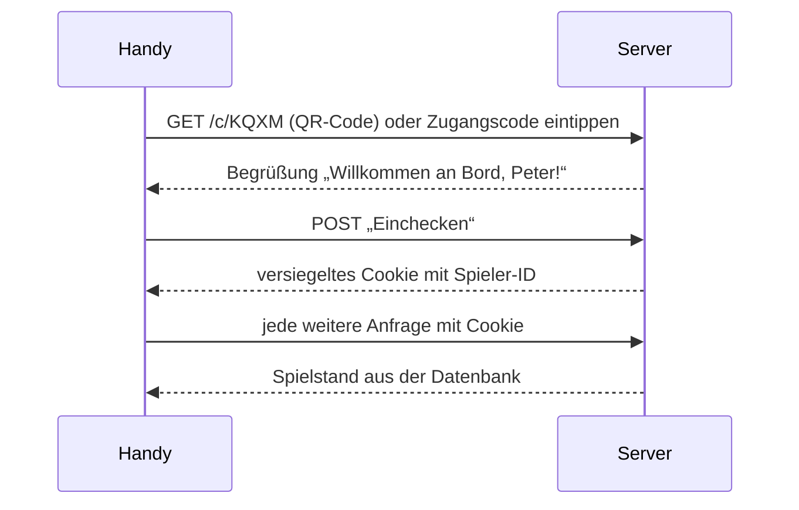

# Zugang und Session

Stand 29.10.2026 · [Übersicht](README.md)

Wie aus der Bordkarte eine Spieler-Session wird, wie die Codes aussehen, wie das Raten gebremst wird und wie der Admin sich anmeldet. Die Regeln aus Spielersicht stehen unter [Eingang und Bordkarte](../framework/eingang-und-bordkarte.md) und [Spielstand und Wiedereinstieg](../framework/spielstand-und-wiedereinstieg.md).

## Vom QR-Code zur Session

Der QR-Code ist eine URL mit dem [Zugangscode](../../CONTEXT.md); QR-Code und Eingabe von Hand führen zum selben Check-in.

- Der Aufruf der URL zeigt nur die Begrüßung. Eingecheckt wird erst mit „Einchecken“, damit eine Linkvorschau (etwa beim Teilen in einem Chat) niemanden eincheckt.
- Die Session ist ein versiegeltes Cookie (nuxt-auth-utils) und hält nur die Spieler-ID. Der Spielstand liegt in der Datenbank. Sessions überstehen Neustarts und Deploys, solange `NUXT_SESSION_PASSWORD` gleich bleibt.
- Das Cookie gilt 14 Tage ab dem Check-in. Das reicht vom Testlauf am 11.11. bis über die Feier am 20.11.
- Gibt es die Spieler-ID nicht mehr (Nutzer gelöscht), landet das Handy wieder beim Check-in.

## Mehrere Geräte

- Jedes Gerät, das den Zugangscode eingibt, ist gleichberechtigt eingeloggt; ein neues Gerät meldet das alte nicht ab. Ein Handywechsel braucht deshalb keinen Sonderfall.
- Beide Geräte zeigen denselben Spielstand. Eine zweite Station zur gleichen Zeit ist trotzdem ausgeschlossen, weil die Regel „eine Station zur Zeit“ am Spieler hängt, nicht am Gerät.

## Codes

| Code | Zeichen | Anzahl | Gültigkeit |
|------|---------|--------|------------|
| Zugangscode | 4 Buchstaben aus `A B C D E F G H J K M N P Q R S T W X Y Z` | 194.481 | ein Spieler, solange er existiert |
| Crewcode | 4 Ziffern `0`–`9` | 10.000 | eine Crew-Bildung an einer Station |

- Buchstaben gegen Ziffern trennen die beiden Codes auf einen Blick. I, L, O, U und V fehlen, weil sie untereinander verwechselbar sind (I/l, U/V, O/Q/D).
- Groß- und Kleinschreibung zählen bei der Eingabe nicht. Das Feld für den Crewcode öffnet die Zahlentastatur (`inputmode="numeric"`).
- Das System erzeugt beide Codes. Ein Crewcode wird bis zum „Zurücksetzen“ nicht wieder vergeben, damit ein gemerkter alter Code nicht in eine fremde Crew führt.
- Einen Filter gegen echte Wörter gibt es nicht; der Admin sieht jeden Zugangscode beim Anlegen.

## Rate-Limit

Gezählt werden Fehlversuche bei der Eingabe von Zugangscode und Crewcode, nicht nach IP-Adresse (im Firmen-WLAN teilen sich alle eine IP).

- **Je Gerät:** 5 Fehlversuche in einer Minute sperren dieses Gerät für 60 Sekunden (Screen 1.5 „Zu viele Versuche“). Das Gerät erkennt der Server an einer zufälligen Kennung im Cookie.
- **Global:** Mehr als 50 Fehlversuche in 10 Minuten sperren die Eingabe für alle für 60 Sekunden. Das bremst auch jemanden, der sein Cookie löscht.
- Die Zähler liegen im Speicher des Pods. Ein Neustart setzt sie zurück; bei rund 60 Spielern und 194.481 Zugangscodes ist das hinnehmbar.

## Admin-Login

- Ein gemeinsames Passwort für das Orgateam, abgelegt als Kubernetes-Secret. Konten je Person gibt es nicht.
- Nach dem Login trägt die Session `admin: true` und einen Fingerabdruck des Passworts. Jede Admin-Anfrage vergleicht ihn mit dem aktuellen Passwort; ein neues Passwort meldet so alle Admins ab, ohne die Spieler-Sessions zu berühren.

## Offene Punkte

- Keine.
